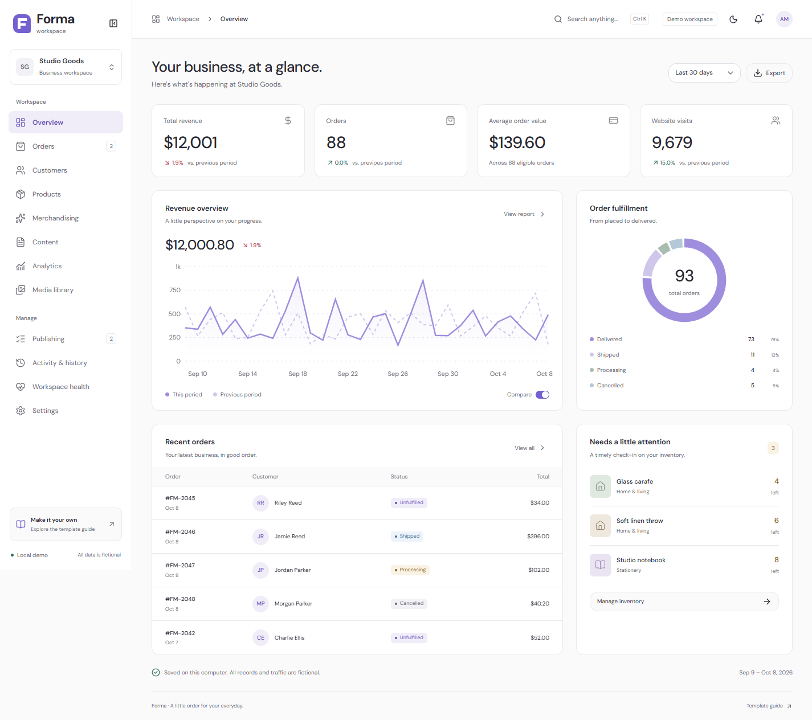

# Forma

A reusable business and store-management dashboard. Fictional business, original branding, working local workflows, and a real SQLite database. Use it as a starting point for future projects or as a portfolio demo.



## Run locally

The source lives at `C:\Portfolio\forma-dashboard-template` as a separate project, outside the client repository.

Requires Node.js 24 or later and pnpm 11. From this folder:

```sh
pnpm install
pnpm dev
```

Open **http://127.0.0.1:4173**. On Windows, you can also double-click **Start Forma.cmd**.

The first package installation downloads open-source dependencies. Once installed, the app runs locally with no internet connection. It requires no accounts, environment files, keys, external databases, or service configuration.

For a built, local preview:

```sh
pnpm build
pnpm start
```

Both modes use the same local database. Stop the server with Ctrl+C. To select another port, set `FORMA_PORT` before starting the server.

## What works

| Area | Features |
| --- | --- |
| Overview | Revenue, eligible orders, average order value, fictional traffic, period comparison, fulfillment, recent orders, low-stock reminders |
| Orders | Create and edit, local payment and fulfillment states, item quantities, discounts, shipping, tracking notes, authoritative totals, stock reservation and cancellation reversal |
| Products | Create, edit, duplicate, archive, categories, SKU, cost and price, inventory, thresholds, image assignment, bulk stock adjustments, selection and CSV export |
| Customers | Fictional contact profiles, company, city, segments, notes, order history, spend, search and CSV export |
| Merchandising | Promotions, percentage/fixed discounts, eligibility tester, featured product selection |
| Content | Pages, announcements, collections, drafts, review status, local previews and publication |
| Analytics | Date periods, daily revenue comparison, categories, popular products, profit, simulated traffic sources and CSV export |
| Media | Original geometric brand artwork; local PNG/JPEG/WebP uploads; names, alt text, product assignments and usage checks |
| Publishing | Review queue and local publication |
| History | Recorded edits, before/after values, restoration of eligible previous revisions |
| Settings | Business identity, display currency, reporting timezone, accents, team profiles, example shipping zones, local alerts, order pause, exports and reset |
| Shell | Responsive/collapsible navigation, keyboard search with Ctrl/Cmd+K, light/dark themes, accessible editors, saved feedback and unsaved-edit prompts |

**Demonstration boundaries:** team roles are editable profile metadata, not authentication or enforced access permissions. Payment, fulfillment, shipping references, and publication are local simulations. Shipping zones are editable examples; order shipping is entered explicitly. Traffic is generated fictional data. Changing currency changes labels without converting the numeric amounts. JSON and CSV exports save local data; there is no external importer or connection.

## Data and privacy

### Hosted portfolio demo

The Vercel deployment uses `pnpm build:demo`: SQLite runs in the visitor's browser through sql.js, and its database bytes persist in IndexedDB on that device. All transactions, validation, inventory and history share the same engine as the local version. Each visitor gets a private fictional workspace; edits are never sent to a backend. Clearing site storage removes those edits. Browser storage must be enabled. Where available, Web Locks also serializes edits across tabs.

To test this mode locally, run `pnpm build:demo` then `pnpm preview:demo` and open `http://127.0.0.1:4176`. The ordinary `pnpm dev` and `pnpm build` / `pnpm start` commands continue using the local Node SQLite server.

GitHub hosts the source and Vercel hosts static application assets. No local SQLite files, environment files or demo edits are included in either upload. The app has no payment, email, hosted database, customer-data or analytics integrations. Fonts and the SQLite WASM binary are bundled with the static assets.

### Local server mode

The database is created automatically at `.local/workspace.sqlite`. It contains only fixtures authored in `shared/seed.ts` and edits you make in this template. All included names, emails, companies, orders, and traffic are fictional. Example emails use `example.test`.

No source customer records, exports, credentials, production database, brand files, or integration code were copied. The local server has no email, payment, hosted storage or analytics integrations. It binds to `127.0.0.1`, rejects outside origins and unexpected hosts, and sets a browser policy restricting connections to its own local origin. Fonts and artwork are served locally. No environment variables other than optional `FORMA_PORT` are read by the server.

Use **Settings → General → Reset demo** to restore fresh fixtures. This also removes uploaded demo media and local history. Export a snapshot first to retain a record of your edits. Reset never touches another project.

## Reuse and customize

1. Copy this whole folder or extract the ZIP produced by `pnpm package` into a new folder.
2. Run `pnpm install` and `pnpm dev`. Each copy creates its own `.local` database.
3. Set your demo business name and accent in Settings.
4. Edit `src/lib/brand.ts` to rename the template and `public/favicon.svg` for its mark.
5. Change colors, typography, spacing, and responsive behavior in `src/styles.css`. The design system is described in `DESIGN.md`.
6. Replace the fictional fixtures in `shared/seed.ts`, then reset your copied demo.
7. Extend types and validation in `shared/schema.ts`, persistence in `server/database.ts`, endpoints in `server/index.ts`, and page modules in `src/pages/`.

The template is independently implemented. There are no imports or paths into another app. Its GitHub repository and Vercel project are independent of the client application.

## Validation and packaging

```sh
pnpm typecheck
pnpm test
pnpm build
pnpm package
```

Packaging creates `release/forma-dashboard-template-1.0.0.zip` using a strict allowlist. It includes source, the lockfile, documentation, and a portfolio screenshot. It excludes installed dependencies, build output, local databases, environment files, logs, caches, and local exports. A new extraction starts with fresh fictional records.

See `docs/DEMO-WALKTHROUGH.md` for a short presentation flow, `docs/CUSTOMIZATION.md` for the reusable boundaries, and `docs/VALIDATION.md` for verification evidence.

## Component credits

Foundational components: [shadcn/ui Base UI](https://ui.shadcn.com/docs/components/base). Animated number: [Cult UI rolling-number](https://cult-ui.com). Icons: [Lucide](https://lucide.dev). Charts: [Recharts](https://recharts.org). Motion: [Motion](https://motion.dev). Font: [DM Sans](https://fonts.google.com/specimen/DM+Sans), bundled through Fontsource and served locally. Third-party source and packages retain their upstream licenses; see `THIRD-PARTY-NOTICES.md`.
